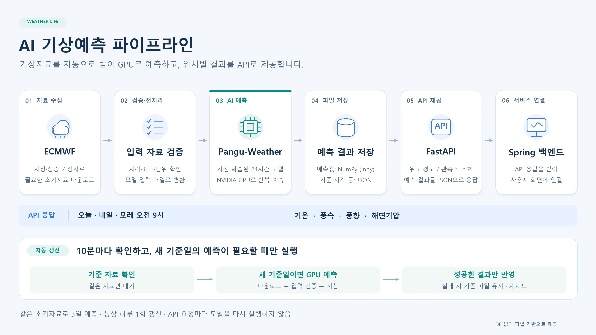

# Weather Life
### AI 기상 예측과 생활 정보를 제공하는 팀 프로젝트

기상청 예보와 AI 기상 예측을 비교하고, 날씨에 맞는 생활 정보를 제공하는 웹 서비스입니다. 이 저장소는 팀 프로젝트 코드와 **전민규의 AI 기상 예측 관련 기여 내용**을 정리한 개인 저장소입니다.

- 팀 저장소: [human-fullstack-projects/weather-life](https://github.com/human-fullstack-projects/weather-life)
- 개인 담당: 기상 예측 모델 학습·비교, Pangu-Weather 예측 서비스, FastAPI 및 실행 환경 구성

## 주요 기여

| 분야 | 수행 내용 |
| --- | --- |
| 초기 모델 학습 | PyTorch 기반 강수 발생 확률·기온 예측 모델 학습 노트북 작성 |
| 모델 비교·선정 | 세 기상모델을 동일 조건에서 비교하고 결과를 보고서로 정리 |
| 예측 파이프라인 | ECMWF 자료 수집·입력 검증·Pangu 추론·결과 저장 구성 |
| API | 지역별 예측 조회, 인증, 입력 검증, 오류 응답 구현 |
| 자동 갱신 | 기준자료 확인, 중복 실행 방지, 실패 시 기존 결과 보존 및 재시도 |
| 실행·문서화 | Docker 구성, 실행 안내, API 명세서 및 테스트 코드 작성 |

## AI 기상 예측 파이프라인

ECMWF 기상자료를 받아 입력을 검증한 뒤, 사전학습된 Pangu-Weather 모델로 예측합니다. 결과를 파일로 저장하고 FastAPI로 제공하며, 팀의 Spring 백엔드가 이를 조회해 화면에 전달합니다.

개인 구현 범위는 AI 예측 파이프라인과 API 제공 영역입니다. Spring 백엔드와 화면은 팀 프로젝트의 연동 구성입니다.

## 1. 초기 PyTorch 모델 개발·학습

프로젝트 초기에는 관측자료를 이용해 직접 예측 모델을 학습했습니다.

| 노트북 | 학습 목표 |
| --- | --- |
| [강수 예측](notebooks/pytorch-weather-prediction/precipitation_prediction.ipynb) | 강남 AWS 400 지점의 다음 24시간 중 강수 발생 확률 |
| [기온 예측](notebooks/pytorch-weather-prediction/temperature_prediction.ipynb) | 같은 지점의 1·24·72시간 후 기온 |

- 학습 자료는 2015~2022년, 검증 자료는 2023~2024년으로 분리했습니다.
- 2025년 자료는 최종 평가용으로 남기고, 두 노트북의 학습·검증에서는 읽지 않도록 구성했습니다.
- 학습 자료에서만 결측 처리·정규화 기준을 계산하고 검증 자료에 적용했습니다.
- 검증 손실 기반 조기 종료, 기준 예측과의 비교, 모델·전처리 정보 저장을 구성했습니다.

두 노트북은 초기 자체 모델 학습 기록이며, 현재 서비스의 Pangu 모델과는 별도입니다. 실행에는 전처리된 `weather_data_v2` 자료와 관련 설정·보조 파일이 필요합니다. 강수 확률은 비와 눈을 구분하지 않으며, 기온 모델은 세 예측 시점만 지원합니다.

## 2. 사전학습 기상모델 비교·선정

GraphCast, Pangu-Weather, FourCastNet, AIFS를 후보로 검토했습니다. 같은 조건의 평가자료를 확보한 세 모델을 상세 비교했으며, AIFS는 필요한 자료를 확보하지 못해 제외했습니다.

### 평가 조건

- 예측 초기시각: 2023년 1월 1일~12월 31일, 매일 00 UTC
- 예측 대상: 24시간 후, 한국시간 다음 날 오전 9시 기온
- 지역: 서울 23개 AWS 관측소
- 관측기간: 2023년 1월 2일~2024년 1월 1일
- 비교 표본: 관측자료와 세 모델 예측이 모두 연결되는 공통 8,325개

### 비교 결과

아래 수치는 첨부한 모델 선정 보고서의 결과입니다.

| 모델 | MAE ↓ | RMSE ↓ | R² ↑ | 오차 ±2°C 이내 ↑ |
| --- | ---: | ---: | ---: | ---: |
| **Pangu-Weather** | **1.169°C** | **1.487°C** | **0.9821** | **83.28%** |
| GraphCast | 1.354°C | 1.649°C | 0.9781 | 76.02% |
| FourCastNet | 1.629°C | 1.988°C | 0.9681 | 66.23% |

이번 평가에서 평균 오차가 가장 작았던 **Pangu-Weather를 서비스에 적용**했습니다. 계절별·관측소별 오차와 편향도 분석하고, 비교 표와 그래프를 생성하도록 구성했습니다.

이 결과는 서울 23개 관측소의 특정 예측 시각에 대한 비교이며, 다른 지역·시간·기상 변수의 성능까지 의미하지 않습니다. R²는 정확도 백분율이 아닙니다. 보고서의 처리시간은 기존 예측자료 추출·전처리 시간으로, 모델 추론 속도를 비교한 값이 아닙니다.

- [모델 선정 보고서 PDF](docs/reports/model-selection-report.pdf)
- [모델 비교 분석 노트북](notebooks/Weather_AI_Model_Comparison.ipynb)

## 3. Pangu-Weather 예측 서비스

ECMWF 지상·상층 기상자료를 모델 입력으로 변환하고, ONNX Runtime과 NVIDIA GPU를 이용해 사전학습된 24시간 모델을 반복 실행하도록 구성했습니다.

- 오늘·내일·모레 오전 9시 예측에 동일한 초기 기상자료 사용
- 예측 배열은 NumPy 파일, 기준시각 등 실행 정보는 JSON으로 저장
- 위도·경도 또는 관측소 번호로 지역별 예측 조회
- 기온·풍속·풍향·해면기압 제공
- HTTP 요청에서는 저장된 결과를 조회하고, 추론은 별도 프로세스에서 실행

AI 서비스는 별도 DB 없이 파일 기반으로 결과를 제공합니다. 반환값은 현재 관측값이나 하루 평균값이 아닌 각 날짜 오전 9시의 예측값입니다.

## 4. FastAPI 기반 내부 API

| 방식 | 경로 | 기능 | 인증 |
| --- | --- | --- | --- |
| GET | `/health` | 예측자료 제공 준비 상태 | 불필요 |
| GET | `/v1/stations` | 관측소 목록 | 필요 |
| GET | `/v1/availability` | 예측 날짜·조회 가능 여부 | 필요 |
| GET | `/v1/forecasts` | 위치별 3일 예측 | 필요 |
| GET | `/v1/update-status` | 자동 갱신 상태 | 필요 |

`X-API-Key` 인증, 좌표 범위 및 요청 방식 검증, 오류 응답을 구현했습니다. 예측 응답에는 기준시각·유효시각·자료 출처·모델 정보가 포함됩니다. 이미 지난 예측 시각은 `is_past_valid_time`으로 구분합니다.

관측소 번호와 좌표는 둘 중 한 방식으로 요청하며, 서버의 한국 날짜를 기준으로 오늘·내일·모레를 선택합니다.

[요청·응답 및 오류 처리 상세 명세 PDF](docs/api/weather-life-api-specification.pdf)

## 5. 자동 갱신과 실행 안정성

자동 갱신 프로그램은 기본 10분 간격으로 사용할 기준자료를 확인합니다. 같은 초기자료에서 세 날짜의 오전 9시 예측을 제공하는 정책에 따라, 통상 기준일마다 하루 한 번 새 예측을 생성합니다.

- 이미 성공한 동일 자료의 중복 계산 방지
- 실행 잠금으로 추론 작업 중복 실행 방지
- 성공한 새 결과를 API 조회에 반영
- 갱신 실패 시 기존 결과 파일 보존 및 재시도
- GPU 사용 실패 시 CPU로 자동 전환하지 않도록 처리

기존 파일을 보존하더라도 요청한 세 날짜를 충족하는 자료가 없으면 API에서 조회 불가 상태를 반환합니다. 자동 갱신은 컴퓨터와 갱신 프로그램이 실행 중일 때 동작합니다.

## 6. 실행 환경과 테스트

API와 GPU 갱신 프로그램을 분리한 Docker 구성을 작성하고, 환경변수·데이터 볼륨·모델 경로 및 로컬 실행 방법을 문서화했습니다. CPU 실행 자원을 제한하는 도구도 구성했습니다.

API 응답과 입력 검증, 예측 입력자료, 자동 갱신, CPU 실행 제한을 확인하는 테스트 코드를 작성했습니다.

- [로컬 실행 안내](ai-service/README.md)
- [Docker 실행 안내](ai-service/DOCKER_RUN_GUIDE.md)
- [CPU 실행 안내](ai-service/CPU_RUN_GUIDE.md)
- [테스트 코드](ai-service/tests/)

## 사용 기술

| 구분 | 기술 |
| --- | --- |
| 초기 모델 학습 | Python, PyTorch, scikit-learn |
| AI 추론 | Pangu-Weather, ONNX Runtime, NVIDIA CUDA |
| 기상자료 처리 | ECMWF Open Data, ecCodes, NumPy |
| API | FastAPI, Pydantic, Uvicorn |
| 비교 분석 | pandas, xarray, Matplotlib, Google Colab |
| 실행·테스트 | Docker, Docker Compose, pytest, HTTPX |
| 협업 | Git, GitHub |

## 주요 자료

| 자료 | 링크 |
| --- | --- |
| 모델 선정 근거와 평가 결과 | [모델 선정 보고서](docs/reports/model-selection-report.pdf) |
| API 요청·응답 규격 | [FastAPI 명세서](docs/api/weather-life-api-specification.pdf) |
| 예측 서비스 전체 흐름 | [파이프라인 이미지](docs/images/ai-weather-pipeline.png) |
| 초기 자체 모델 학습 | [PyTorch 노트북 2개](notebooks/pytorch-weather-prediction/) |
| 사전학습 모델 비교 | [비교 분석 노트북](notebooks/Weather_AI_Model_Comparison.ipynb) |
| 초기 개인 작업 기록 | [2026-10-13 README](docs/PERSONAL_README_2026-10-13.md) |
