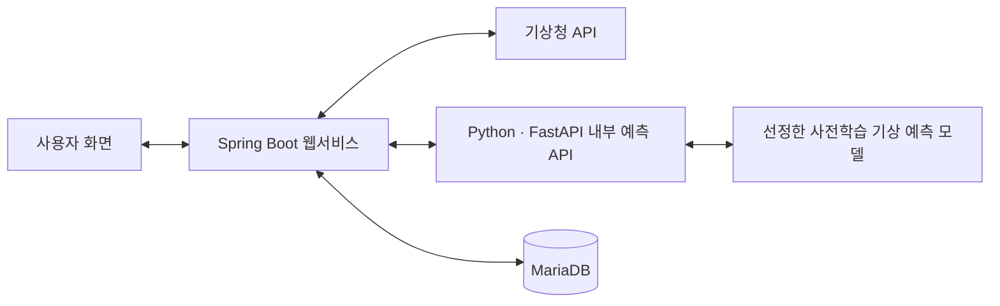

# Weather Life

**날씨 비교와 서울 주말 행사·의상 추천 웹 서비스**

외부에서 제공하는 사전학습 기상 예측 모델을 활용해 기상청 예보와 비교하고, 서울에서 주말에 열리는 행사와 오늘 날씨에 맞는 간단한 의상 정보를 함께 제공하는 팀 프로젝트입니다.

> **진행 중인 프로젝트 · 문서 기준: 2026-10-13**
>
> 현재 저장소에는 Spring Boot 초기 프로젝트와 화면 템플릿의 기본 구조가 있습니다. 서비스 기능과 AI 모델 연동은 개발 예정이며, 아래에서 수행한 내용과 앞으로의 계획을 구분합니다.

- **팀 원본 저장소:** [human-fullstack-projects/weather-life](https://github.com/human-fullstack-projects/weather-life)
- **개인 포크:** [min-gyu-jeon/weather-life](https://github.com/min-gyu-jeon/weather-life)
- **개인 담당:** 전민규 — AI 모델 활용 및 내부 예측 API

이 README는 팀 프로젝트의 개요와 전민규의 담당 업무를 정리한 개인 포크용 문서입니다.

## 서비스 기획

| 기능 | 내용 | 진행 상태 |
| --- | --- | --- |
| AI 기상 예측 활용 | 기존 사전학습 모델을 비교하고 서비스에 사용할 모델 선정 | 비교·선정 예정 |
| 기상청 예보 비교 | 선정한 모델의 예측 결과와 기상청 예보를 함께 제공 | 구현 예정 |
| 서울 주말 행사 추천 | 서울에서 주말에 열리는 행사 정보 추천 | 구현 예정 |
| 오늘의 의상 추천 | 오늘 날씨에 맞는 간단한 의상 정보 제공 | 구현 예정 |

## 개인 담당 업무와 수행 내용

### 수행한 내용

- **Python·PyTorch 모델 학습 실습:** 프로젝트 초기 단계에서 모델 학습을 진행하며 딥러닝 프레임워크 활용을 학습했습니다. 해당 실습 코드와 실험 기록은 현재 이 저장소의 `main` 브랜치에 포함되어 있지 않습니다.
- **모델 활용 방향 조정:** 멘토링 피드백을 반영해 직접 모델을 개발하는 방식에서 기존 사전학습 기상 예측 모델을 활용하는 방식으로 방향을 조정했습니다.
- **비교 후보 선정:** GraphCast, Pangu-Weather, FourCastNet, ECMWF AIFS를 비교 대상으로 정했습니다.

### 진행할 업무

- **모델 비교·선정:** 후보 모델의 예측 성능과 실행 조건을 확인하고, 프로젝트에 적용할 모델을 선정할 계획입니다.
- **내부 예측 API 개발:** 선정한 모델의 예측 결과를 Spring Boot 웹서비스에서 활용할 수 있도록 Python·FastAPI 기반 API를 구성할 계획입니다.
- **요청·응답 처리:** 입력값 검증과 예측 결과·처리 상태의 JSON 응답 구조를 설계하고 구현할 계획입니다.
- **Docker 실행 환경 구성:** API와 필요한 라이브러리를 컨테이너로 구성하고, API 실행 및 웹서비스 연동을 확인할 계획입니다.

## 모델 비교 계획

| 후보 모델 | 제공 기관 | 현재 상태 |
| --- | --- | --- |
| GraphCast | Google DeepMind | 비교 대상 |
| Pangu-Weather | Huawei | 비교 대상 |
| FourCastNet | NVIDIA | 비교 대상 |
| AIFS (Artificial Intelligence Forecasting System) | ECMWF | 비교 대상 |

**최종 모델은 아직 선정하지 않았습니다.** 초기 PyTorch 학습 실습과 위 후보 모델 4종의 활용 검토는 별도의 작업이며, 후보 모델의 비교 결과는 평가 후 추가할 예정입니다.

비교 과정에서는 다음 항목을 확인할 계획입니다.

- 예측할 기상 변수, 지역, 예측 시점과 예측 시간 범위
- 입력 데이터의 종류, 확보 방법과 전처리 조건
- GPU·메모리 등 실행 자원과 추론 시간
- 모델 및 가중치의 이용 조건과 서비스 적용 가능성
- 동일한 조건에서 직접 평가할 수 있는 범위

직접 실행해 얻은 평가 결과와 공식 문서·논문에서 확인한 성능은 구분해 기록할 예정입니다. 기상청 예보와 모델 예측의 차이는 비교 정보로 제공하고, 정확도를 평가할 때는 관측값을 기준으로 평가 조건을 맞출 계획입니다.

## 기술 스택과 적용 상태

| 구분 | 기술 | 적용 상태 |
| --- | --- | --- |
| 프로젝트 기본 환경 | Java 21, Spring Boot, Gradle | 현재 저장소에 설정 |
| 화면 템플릿 | Thymeleaf, HTML | 의존성 및 기본 템플릿 구성 |
| 데이터 접근·검증 | Spring Data JPA, Bean Validation, MariaDB JDBC 드라이버 | 의존성 등록, 기능 구현 및 DB 연동 예정 |
| 개인 모델 학습 실습 | Python, PyTorch | 초기 학습에 활용, 실습 코드는 현재 저장소에 미포함 |
| 웹 요청 처리·화면 동작 | Spring MVC, JavaScript | 구성 및 구현 예정 |
| 내부 예측 API | Python, FastAPI, REST API, JSON | 설계·구현 예정 |
| 데이터 저장 | MariaDB | 연결 설정 및 데이터 구조 구현 예정 |
| 실행 환경 | Docker | API 컨테이너 구성 예정 |
| 협업·버전 관리 | Git, GitHub | 팀 저장소 및 개인 포크 운영 |

프로젝트 전체의 기술 구성과 개인 담당 범위를 구분했습니다. 의존성 등록은 해당 기술을 활용한 기능 구현 완료를 의미하지 않습니다.

## 서비스 구성 계획

아래는 목표 구성입니다. 현재 실행 가능한 연동 구조를 의미하지 않습니다.



- **Spring Boot:** 화면 요청 처리, 기상청 데이터 연동, 예측 결과 활용 및 데이터 저장
- **FastAPI:** 모델 추론 요청 처리와 예측 결과·처리 상태 반환
- **Docker:** 내부 예측 API와 필요한 라이브러리의 실행 환경 구성

서울 주말 행사와 의상 추천 기능의 상세 처리 방식은 구현 과정에서 정리할 예정입니다.

## 현재 저장소 구조

```text
weather-life/
├── README.md
└── weather-life/
    ├── build.gradle
    ├── gradlew / gradlew.bat
    └── src/
        ├── main/
        │   ├── java/com/weatherlife/
        │   │   └── WeatherLifeApplication.java
        │   └── resources/
        │       ├── application.properties
        │       └── templates/
        │           ├── dashboard/
        │           ├── fragments/
        │           └── layout/
        └── test/
```

현재 AI 추론 코드, FastAPI 서버, Docker 설정 파일은 포함되어 있지 않습니다. 실행 방법은 필요한 설정과 기능 구현을 확인한 뒤 추가할 예정입니다.

## 다음 단계

- [ ] 후보 모델의 입력 데이터·실행 자원·이용 조건 확인
- [ ] 비교 조건을 정하고 모델 평가 결과 기록
- [ ] 서비스에 적용할 모델 선정 및 선정 근거 정리
- [ ] 내부 예측 API의 요청·응답 규격 설계와 구현
- [ ] Docker 실행 환경 구성
- [ ] Spring Boot 웹서비스와 예측 API 연동 확인
- [ ] 수행한 작업의 코드·실험 결과·실행 방법 문서화
