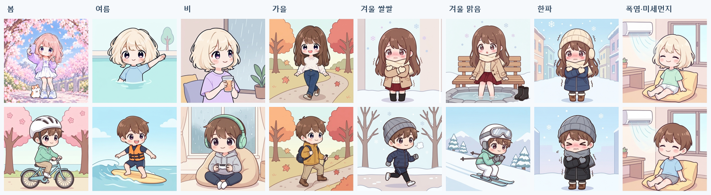
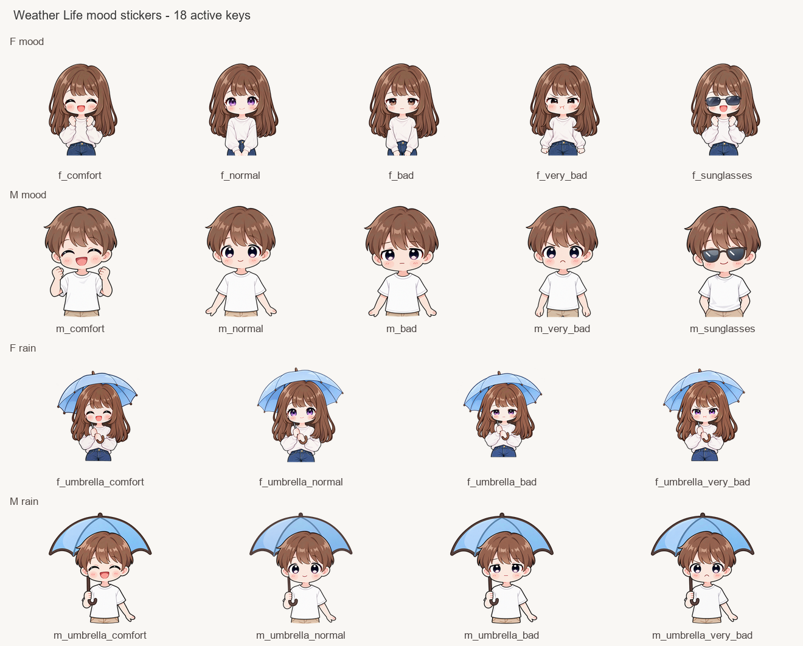
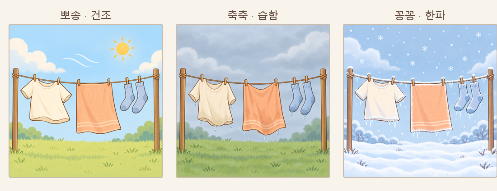
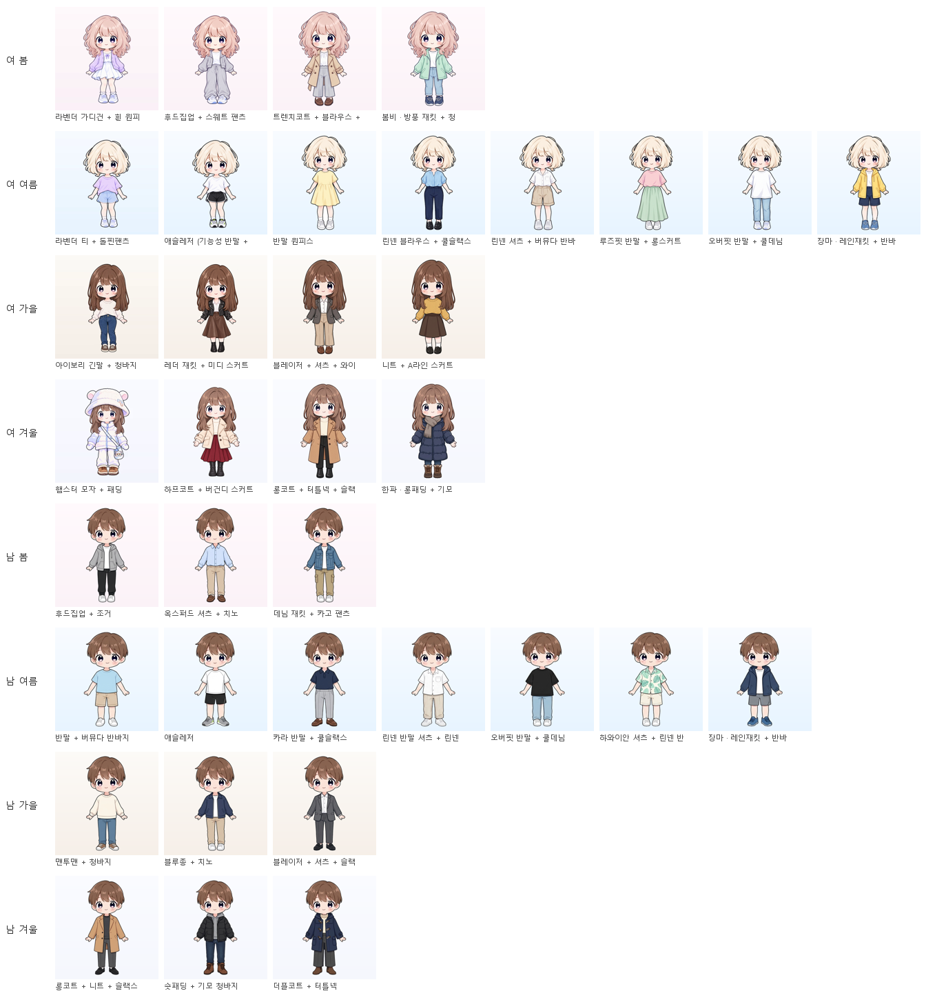

# weather-unit — Weather Life 날씨 캐릭터 그림 모음

Weather Life(팀 SixOn) 웹페이지에 들어갈 **날씨 캐릭터 최종 파일**과, 어떤 날씨에 어떤 파일을 쓰는지 적은 **기준표**를 모아 둔 저장소입니다.
최종본 날짜: **2026-10-15**

> **먼저 알아 둘 것**
> - 그림은 모두 **옷을 다 입은 상태로 미리 만들어 둔 완성 사진 · 영상**입니다. 화면에서 옷을 입히거나 합치지 않습니다.
> - 기준표(`static/weather/rules/weather_character_rules.json`)는 「이 날씨면 이 파일을 꺼낸다」를 적어 둔 **고르는 표**일 뿐입니다. 실제 조합은 팀 코드가 합니다.
> - `static/weather/` 폴더를 `weather-life`의 `src/main/resources/static/weather/`에 **폴더째 복사**하면 됩니다.
> - 영상은 **MP4 권장**입니다. GIF는 혹시 몰라 같이 만든 예비 파일입니다(용량이 큼). 정지 그림은 `_poster.png`.

## 한눈에 보기

| 무엇 | 개수 | 어디 | 설명 문서 |
|---|---|---|---|
| **① 추천 복장 (착장 세트)** | 36벌 (여 20 · 남 16) × PNG · MP4 · GIF | `static/weather/outfits/assets/characters/` | [사용법 · 세트 표](static/weather/outfits/README.md) |
| **② 옷 아이콘 · ③ 소품 아이콘** | 옷 56 · 소품 19 (SVG) | `static/weather/outfits/assets/icons/` | [사용법 · 아이콘 표](static/weather/outfits/README.md) |
| **④ 추천 액티비티** | 16개 (여 8 · 남 8) × MP4 · GIF · PNG | `static/weather/activities/` | [액티비티 표](static/weather/activities/README.md) |
| **⑤ 불쾌지수 스티커** | 여 · 남 × 쾌적/보통/나쁨/매우 나쁨 + 우산 · 선글라스 | `static/weather/stickers/` | [기준표 README](static/weather/rules/README.md) |
| **⑥ 빨래** | 3장 (뽀송 · 축축 · 꽁꽁) | `static/weather/laundry/` | [기준표 README](static/weather/rules/README.md) |
| **⑦ 기준표 (고르는 표)** | JSON 1 · 같은 내용 JS 1 · 예시 함수 1 | `static/weather/rules/` | **[기준표 README — 처음이면 이걸 보시면 좋아요](static/weather/rules/README.md)** |
| ⑧ 원본 그림 | 착장 원본 · 액티비티 원본(Gemini 2×2) | `characters/` | 아래 「원본 그림」 |
| 실제 화면 목업 | 1 | `preview/ui_mockup/index.html` | 저장소를 받아 **더블클릭으로 열기** (GitHub 화면에서는 코드만 보임) |



 



## 어떻게 고르나

자세한 표와 코드 예시는 [기준표 README](static/weather/rules/README.md)를 보시면 좋아요.

1. **계절** = 달(3~5 봄 · 6~8 여름 · 9~11 가을 · 12~2 겨울). 28℃ 이상이면 여름, 5℃ 이하면 겨울 모습.
2. **예외가 먼저**: 비 · 소나기 · 천둥 → 집에서 쉬기 / 미세먼지 나쁨 · 폭염(33℃ 이상 또는 불쾌지수 80 이상) → 에어컨 휴식 / 한파(-5℃ 이하) → 추위에 떨기.
3. 예외가 아니면 **계절 액티비티** (여: 벚꽃 셀카 · 수영 · 단풍 산책 · 겨울 산책/온천 · 남: 자전거 · 서핑 · 등산 · 조깅/스키).
4. **추천 복장**: 백엔드 의상 추천 결과가 있으면 그 결과로 그림을 고릅니다(`outfits/outfit_visual.js`의 `pickOutfitVisual`). 결과가 없을 때만 기준표(계절 + 기온)로 고릅니다.
5. **스티커**: 비 → 우산 · 맑고 30℃ 이상 또는 자외선 8 이상 → 선글라스 · 그 밖에는 불쾌지수 단계(68 / 75 / 80) 표정.
6. **빨래**: -5℃ 이하 꽁꽁 · 비나 습도 70% 이상 축축 · 그 밖에 뽀송.
7. 소품(우산 · 마스크 등 아이콘)은 아직 `outfits/outfit_visual.js`의 `pickAccessories`에 따로 있습니다.

기상청 API는 하늘 · 강수를 **숫자 코드**로 보냅니다. 기준표에 코드 → 글자 변환표가 있어서 숫자를 그대로 넣어도 됩니다. 값이 빠지면 기본값으로 계속 진행합니다(기온만 꼭 필요).

### weather-life에 넣는 법 (Thymeleaf 예시)

```html
<video class="weather-card" autoplay muted loop playsinline
       th:poster="@{/weather/activities/activity_autumn_walk_340_poster.png}"
       aria-label="단풍 공원을 산책하는 캐릭터">
  <source th:src="@{/weather/activities/activity_autumn_walk_340.mp4}" type="video/mp4">
  
</video>
```

움직임 줄이기 설정을 한 사용자에게는 영상을 숨기고 같은 자리에 `_poster.png`를 보여 줍니다(기능명세 테마-02).

```css
@media (prefers-reduced-motion: reduce) { video.weather-card { display: none; } }
```

## 원본 그림 — `characters/`

| 파일 | 내용 |
|---|---|
| `outfit_sets/<세트 key>_transparent.png` | 착장 세트 원본 (배경 없음) + 남자 기본 `m_base` |
| `spring_outfit_transparent.png` · `summer_…` · `autumn_…` · `winter_outfit_transparent.png` | 계절 기본 착장 원본 (= 세트 `f_*_basic`) |
| `spring_activity_square_source.png` | 봄 액티비티(햄스터 점프 셀카)를 만들 때 쓴 정사각 원본 |
| `activity_sheets/<key>.png` | **추천 액티비티 원본** (Gemini가 만든 2×2 동작 그림 → `tools/activity/make_activity.py`로 영상) |

**캐릭터 규칙**
- 여자: 계절마다 머리가 다르고(봄 로즈베이지 웨이브 · 여름 크림 단발 · 가을/겨울 갈색 긴머리), 얼굴 · 체형은 같고 옷만 바뀝니다. 스티커는 갈색 긴머리 한 명.
- 남자: 한 명(짧은 갈색 댄디컷)으로 통일했습니다.
- 노출이 많은 옷(나시 · 스포츠 탑)은 쓰지 않습니다. 위험해 보이는 액티비티(서핑 · 스키)는 안전 장비를 그렸습니다.

## 📁 작업 과정 · 프로그램 (그림을 고치거나 더 만들 때 보시면 좋아요)

| 폴더 · 파일 | 내용 |
|---|---|
| `preview/ui_mockup/` | 실제 화면 가정 UI 목업 — 예시 날씨 14개 · 여/남 · 불쾌지수 막대. 기준표대로 그림이 바뀜 |
| `preview/outfit_link/` | 백엔드 결과 JSON → 세트 · 아이콘 미리보기 |
| `tools/rules/` | 기준표 검사(`check_rules.py`) · JSON → JS 변환(`make_rules_js.py`, **JSON을 고치면 꼭 다시 실행**) · 샘플 |
| `tools/activity/` | 추천 액티비티 영상을 만든 프로그램 — [설명](tools/activity/README.md) |
| `tools/outfit_link/` | 착장 세트 · 아이콘 · 연결표를 만든 프로그램 — [설명](tools/outfit_link/README.md) |
| `ai_practice/temperature/` | 기온 예측 연습 Colab 노트북과 ASOS 서울(108) 데이터 |
| `docs/` | 한눈에 보기 그림 · 계획 보고 · 착장 조사 · Gemini 요청문 · 출처 기록 |
| `MANIFEST.csv` | 전체 파일 목록 (크기와 SHA-256 — 파일이 바뀌지 않았는지 확인하는 값) |

10-13에 만든 계절 카드 폴더(`static/weather/spring` 등)와 그 목업 · 프로그램은 새 파일로 대체되어 지웠습니다(이전 커밋에 남아 있음).

## 출처

캐릭터 이미지는 이 프로젝트에서 AI로 생성 · 편집했습니다. 10-13까지는 OpenAI ImageGen(Codex), 10-14 착장 세트 · 남자 캐릭터와 10-14~15 추천 액티비티는 Google Gemini, 10-15 스티커 · 빨래는 OpenAI ImageGen(Codex)으로 만들었습니다. 이 프로젝트의 기존 캐릭터 그림을 첨부해 같은 캐릭터로 편집했습니다. 자세한 기록은 `docs/출처_사용조건.csv`.
옷 · 소품 아이콘은 코드(SVG)로 직접 그렸습니다(`tools/outfit_link/icons_svg.py` · `acc_svg.py`).
옷 카탈로그(`clothing-catalog.json`)는 팀 백엔드 자료라 이 저장소에 넣지 않았습니다.
기온 데이터: 기상청 기상자료개방포털 종관기상관측(ASOS) 시간 자료, 서울(108).
