# 옷 추천 → 캐릭터 · 옷 아이콘 · 소품 (outfits)

백엔드가 날씨(기온 · 하늘 · 강수 · 습도 등)를 보고 **옷 카탈로그(`clothing-catalog.json`)에서 옷을 골라 보내면**,
이 폴더의 파일로 화면에 **① 그 옷차림의 캐릭터 그림 ② 옷 아이콘과 이름 ③ 챙길 소품**을 보여 줍니다.
날씨 판단은 백엔드가 하고, 여기서는 **그림만 고릅니다**. 모든 그림은 미리 만들어 두었으므로 어느 컴퓨터에서도 그대로 동작합니다.

- 착장 세트(캐릭터 그림) **36벌** = 여 20 · 남 16 — 각각 340×340 정지 PNG · MP4 · GIF
- 옷 아이콘 **56개** — 카탈로그 옷 **170개 전부**가 아이콘 1개에 연결됨
- 소품 아이콘 **19개** + 추천 기준 초안
- 최종본: 2026-10-14

## 1. 폴더 구성

```
static/weather/outfits/
├─ outfit_visual_map.json   ← 연결표 (옷 id → 아이콘·짧은 이름 / 착장 세트 / 소품)  ※ 팀은 이 파일을 씀
├─ outfit_visual.js         ← 고르는 함수 2개: pickOutfitVisual · pickAccessories (순수 JS, 라이브러리 없음)
├─ outfit_visual_map.js     ← JSON과 같은 내용 (서버 없이 HTML을 파일로 열 때용 — 미리보기 페이지가 씀)
└─ assets/
   ├─ characters/   <세트 key>_340_poster.png · _340.mp4 · _340.gif   (36벌 × 3)
   └─ icons/        <아이콘 key>.svg (옷 56) · acc_<소품 key>.svg (소품 19)
```

`weather-life` 프로젝트에는 이 폴더를 통째로 `src/main/resources/static/weather/outfits/`에 복사하면 됩니다.
JSON 안의 그림 경로(`assets/...`)는 이 폴더 기준 상대 경로입니다.

## 2. 화면에 넣는 법

### 2-1. 백엔드 결과 → 캐릭터 + 옷 아이콘

백엔드 결과 예시(의상 추천 API):
```json
{"outfits":[{"structure":"SEPARATES",
  "top":{"id":"C019","name":"후드 티셔츠","slot":"TOP"}, "bottom":{"id":"C045","name":"조거 팬츠","slot":"BOTTOM"},
  "onePiece":null, "innerTop":null, "outer":{"id":"C058","name":"블루종","slot":"OUTER"}, "outerUsage":"WEAR",
  "baseLayer":null, "shoes":{"id":"C138","name":"기본 운동화","slot":"SHOES"}, "accessories":[] }]}
```

```html
<script src="/weather/outfits/outfit_visual.js"></script>
<script type="module">   // module = 맨 위에서 await 사용 가능
  const BASE = "/weather/outfits/";
  const map = await (await fetch(BASE + "outfit_visual_map.json")).json();
  const api = await (await fetch("/api/...")).json();          // 백엔드 결과
  const r = pickOutfitVisual(api.outfits[0], "F", map);        // 성별 "F" | "M"

  // ① 캐릭터 (추천 복장 칸 — 정지 그림 권장, 영상이 필요하면 r.set.mp4 / r.set.gif)
  img.src = BASE + r.set.poster;   img.alt = r.set.label;

  // ② 착장 구성 (칸마다 아이콘 + 짧은 이름)
  r.icons.forEach(x => addRow(BASE + x.iconFile, x.name));   // x.name = 짧은 이름(예: 방한화), x.fullName = 카탈로그 이름
</script>
```

반환값 `r`:
| 값 | 뜻 |
|---|---|
| `r.setKey`, `r.set` | 고른 착장 세트 (`label` · `poster` · `mp4` · `gif` · `season` · `occasion`) |
| `r.icons[]` | 칸별 `slot` · `slotLabel` · `id` · `name`(짧은 이름) · `fullName` · `iconKey` · `iconFile` · `usage`(아우터를 입는지/챙기기만 하는지) |
| `r.score` | 얼마나 비슷한지 (높을수록 비슷) |

**세트 고르는 법**: 같은 성별 세트 중 백엔드 결과와 **옷이 가장 많이 겹치는** 세트를 고릅니다.
아우터 종류(없음 · 얇은 겉옷 · 재킷 · 코트 · 패딩)와 하의 모양(반바지 · 바지 · 스커트 · 원피스)이 같으면 각 4점,
운동복 · 비 대비 옷이 같으면 각 3점, 칸별 아이콘이 같으면 2점(신발 1점), 같은 옷 id면 1점을 더합니다.
아우터를 입지 않고 챙기기만(`outerUsage` ≠ `WEAR`) 하면 그림을 고를 때는 아우터가 없는 것으로 봅니다.

### 2-2. 날씨 → 소품

```js
const accs = pickAccessories(
  { temp: 26, sky: "흐림", pty: "비", pop: 90, precip: 25, humidity: 92, wind: 4, di: 79, tempMin: 23, tempMax: 27, pm: null },
  api.outfits[0], map);              // → [{key, label, file, why}] 기본 3개, 비·미세먼지 날 4개
accs.forEach(a => addAcc(BASE + a.file, a.label));
```
날씨 값 중 없는 것은 무시합니다. 미세먼지(`pm`: 좋음/보통/나쁨/매우나쁨)는 **팀 자료가 아직 없어서** 값이 올 때만 KF94 마스크가 나옵니다.

### 2-3. Thymeleaf로 서버에서 바로 넣을 때

```html

 <span th:text="${shortName}">방한화</span>
```
서버(Java)에서 세트를 고르려면 `outfit_visual.js`의 점수 규칙을 그대로 옮기면 됩니다(코드 50줄 정도).

### 2-4. 확인용 페이지

- `preview/outfit_link/index.html` — 백엔드 결과를 붙여넣으면 고른 세트 · 아이콘이 바로 보임
- `preview/ui_mockup/index.html` — 실제 화면 가정 목업 (여/남 · 예시 날씨 11개 · 불쾌지수 온도계 · 소품)

## 3. 착장 세트 — 여 20벌 (머리는 계절별로 다름: 봄 로즈베이지 웨이브 · 여름 크림 단발 · 가을/겨울 갈색 긴머리)

| 계절 | 그림 | 세트 이름(key) | 용도 | 옷 (카탈로그 id) |
|---|---|---|---|---|
| 봄 | 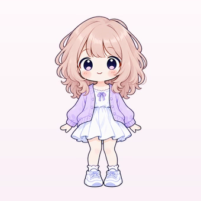 | **라벤더 가디건 + 흰 원피스**<br>`f_spring_basic` | 일상 | 크롭 가디건 `C120` · 미니 원피스 `C111` · 기본 운동화 `C138` |
| 봄 | 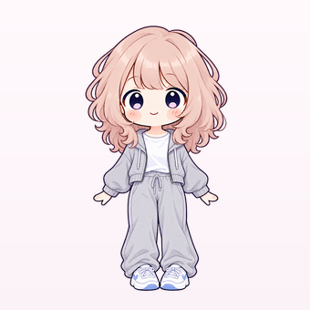 | **후드집업 + 스웨트 팬츠**<br>`f_spring_campus` | 일상 | 크롭 집업 `C122` · 반팔 티 `C001` · 조거 팬츠 `C045` · 기본 운동화 `C138` |
| 봄 | 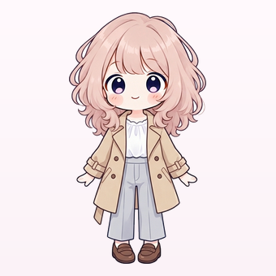 | **트렌치코트 + 블라우스 + 슬랙스**<br>`f_spring_trench` | 출근 | 트렌치코트 `C059` · 시폰 블라우스 `C081` · 와이드 슬랙스 `C094` · 로퍼 `C139` |
| 봄 | 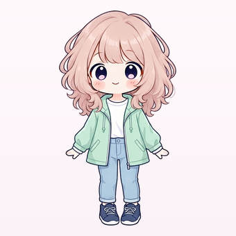 | **봄비 · 방풍 재킷 + 청바지**<br>`f_spring_rain` | 비 | 방풍 재킷 `C135` · 긴팔 티 `C008` · 워싱 청바지 `C033` · 방수 운동화 `C141` |
| 여름 | 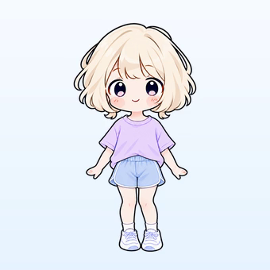 | **라벤더 티 + 돌핀팬츠**<br>`f_summer_basic` | 일상 | 반팔 티 `C001` · 숏 팬츠 `C028` · 기본 운동화 `C138` |
| 여름 | 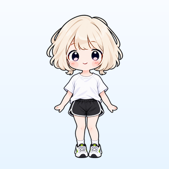 | **애슬레저 (기능성 반팔 + 러닝 쇼츠)**<br>`f_summer_athleisure` | 운동 | 기능성 반팔 `C143` · 러닝 쇼츠 `C149` · 통풍 운동화 `C137` |
| 여름 | 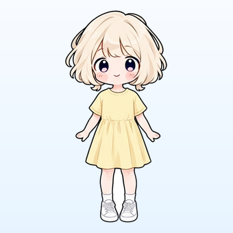 | **반팔 원피스**<br>`f_summer_onepiece` | 일상 | 반팔 원피스 `C107` · 통풍 운동화 `C137` |
| 여름 | 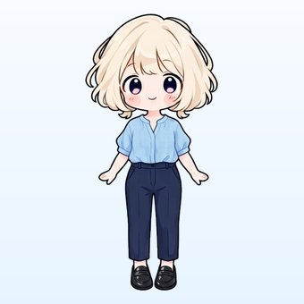 | **린넨 블라우스 + 쿨슬랙스**<br>`f_summer_office` | 출근 | 린넨 블라우스 `C076` · 쿨슬랙스 `C040` · 로퍼 `C139` |
| 여름 | 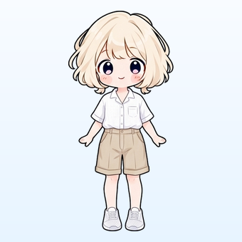 | **린넨 셔츠 + 버뮤다 반바지**<br>`f_summer_linen` | 일상 | 린넨 셔츠 `C004` · 5부 반바지 `C091` · 통풍 운동화 `C137` |
| 여름 | 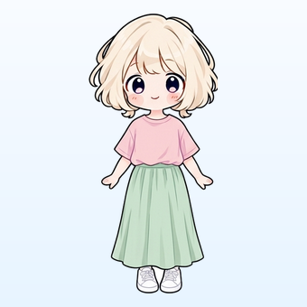 | **루즈핏 반팔 + 롱스커트**<br>`f_summer_skirt` | 일상 | 루즈핏 티 `C075` · 롱스커트 `C100` · 통풍 운동화 `C137` |
| 여름 | 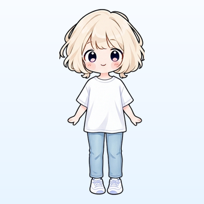 | **오버핏 반팔 + 쿨데님**<br>`f_summer_denim` | 일상 | 오버핏 반팔티 `C002` · 쿨데님 `C037` · 통풍 운동화 `C137` |
| 여름 | 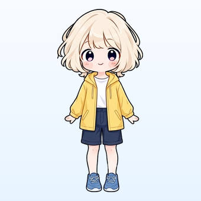 | **장마 · 레인재킷 + 반바지**<br>`f_summer_rain` | 비 | 레인재킷 `C134` · 반팔 티 `C001` · 버뮤다 팬츠 `C029` · 방수 운동화 `C141` |
| 가을 | 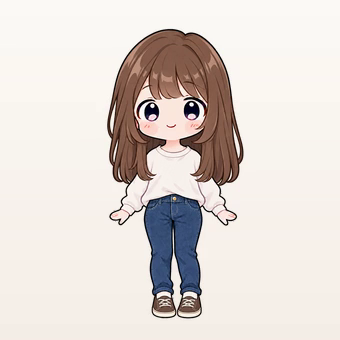 | **아이보리 긴팔 + 청바지**<br>`f_autumn_basic` | 일상 | 긴팔 티 `C008` · 일자 청바지 `C034` · 기본 운동화 `C138` |
| 가을 | 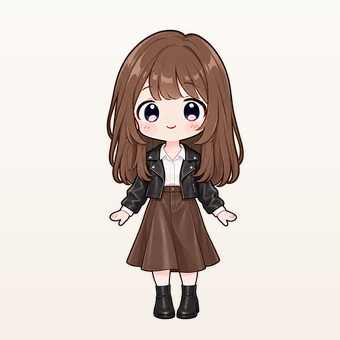 | **레더 재킷 + 미디 스커트**<br>`f_autumn_leather` | 일상 | 라이더 재킷 `C056` · 드레스 셔츠 `C011` · 미디스커트 `C097` · 앵클부츠 `C140` |
| 가을 | 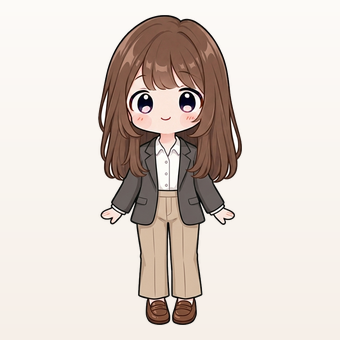 | **블레이저 + 셔츠 + 와이드 슬랙스**<br>`f_autumn_office` | 출근 | 블레이저 `C053` · 옥스퍼드 셔츠 `C012` · 와이드 슬랙스 `C094` · 로퍼 `C139` |
| 가을 | 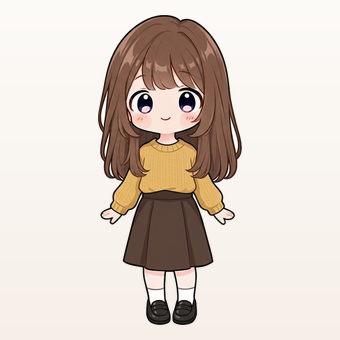 | **니트 + A라인 스커트**<br>`f_autumn_knit` | 일상 | 니트 `C022` · A라인 스커트 `C098` · 로퍼 `C139` |
| 겨울 | 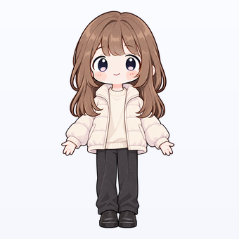 | **숏패딩 + 맨투맨 + 울 팬츠**<br>`f_winter_padding` | 일상 | 숏패딩 `C066` · 맨투맨 `C017` · 울 팬츠 `C043` · 방한화 `C142` |
| 겨울 | 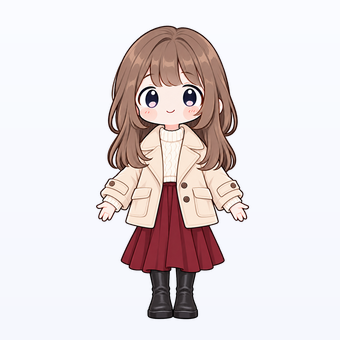 | **하프코트 + 버건디 스커트**<br>`f_winter_halfcoat` | 일상 | 숏코트 `C129` · 니트 `C022` · 울 스커트 `C103` · 앵클부츠 `C140` |
| 겨울 | 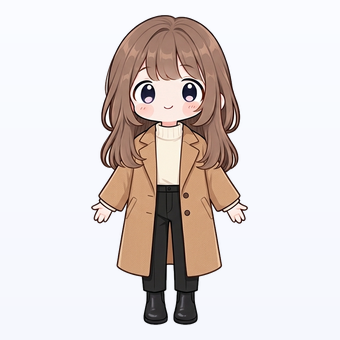 | **롱코트 + 터틀넥 + 슬랙스**<br>`f_winter_longcoat` | 출근 | 울 롱코트 `C128` · 터틀넥 니트 `C025` · 기모 슬랙스 `C042` · 앵클부츠 `C140` |
| 겨울 | 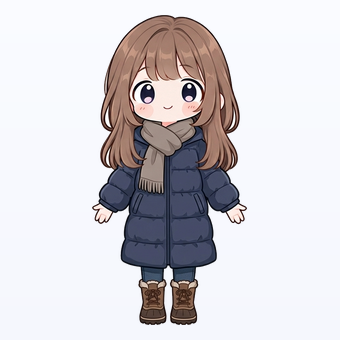 | **한파 · 롱패딩 + 기모 청바지**<br>`f_winter_longpadding` | 일상 | 롱패딩 `C067` · 후드 티셔츠 `C019` · 기모 청바지 `C036` · 방한화 `C142` |

## 4. 착장 세트 — 남 16벌 (한 명으로 통일: 짧은 갈색 댄디컷)

| 계절 | 그림 | 세트 이름(key) | 용도 | 옷 (카탈로그 id) |
|---|---|---|---|---|
| 봄 | 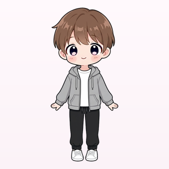 | **후드집업 + 조거**<br>`m_spring_zipup` | 일상 | 집업 후드티 `C051` · 반팔 티 `C001` · 조거 팬츠 `C045` · 기본 운동화 `C138` |
| 봄 | 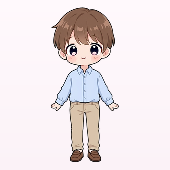 | **옥스퍼드 셔츠 + 치노**<br>`m_spring_shirt` | 출근 | 옥스퍼드 셔츠 `C012` · 치노 팬츠 `C039` · 로퍼 `C139` |
| 봄 | 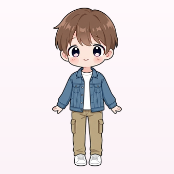 | **데님 재킷 + 카고 팬츠**<br>`m_spring_denim` | 일상 | 데님 재킷 `C054` · 반팔 티 `C001` · 카고 팬츠 `C044` · 기본 운동화 `C138` |
| 여름 | 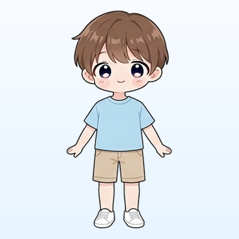 | **반팔 + 버뮤다 반바지**<br>`m_summer_tee` | 일상 | 반팔 티 `C001` · 버뮤다 팬츠 `C029` · 기본 운동화 `C138` |
| 여름 | 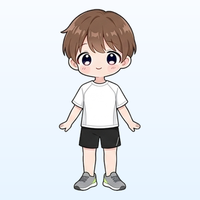 | **애슬레저**<br>`m_summer_athleisure` | 운동 | 기능성 반팔 `C143` · 러닝 쇼츠 `C149` · 통풍 운동화 `C137` |
| 여름 | 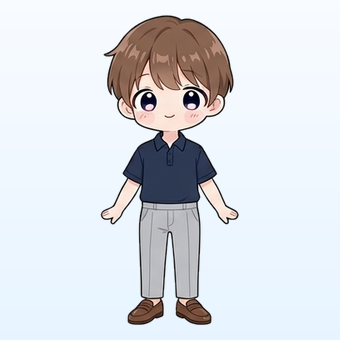 | **카라 반팔 + 쿨슬랙스**<br>`m_summer_office` | 출근 | 카라티 `C003` · 쿨슬랙스 `C040` · 로퍼 `C139` |
| 여름 | 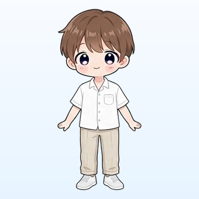 | **린넨 반팔 셔츠 + 린넨 바지**<br>`m_summer_linen` | 일상 | 린넨 셔츠 `C004` · 린넨 바지 `C041` · 통풍 운동화 `C137` |
| 여름 | 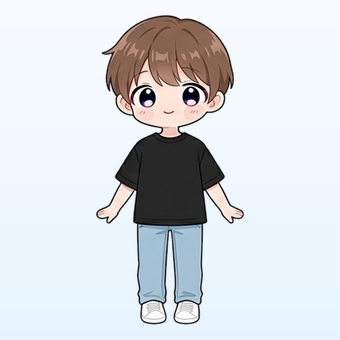 | **오버핏 반팔 + 쿨데님**<br>`m_summer_denim` | 일상 | 오버핏 반팔티 `C002` · 쿨데님 `C037` · 통풍 운동화 `C137` |
| 여름 | 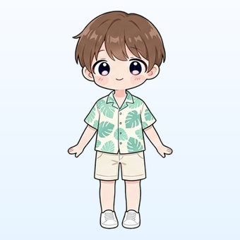 | **하와이안 셔츠 + 린넨 반바지**<br>`m_summer_hawaiian` | 일상 | 하와이안 셔츠 `C005` · 린넨 반바지 `C030` · 통풍 운동화 `C137` |
| 여름 | 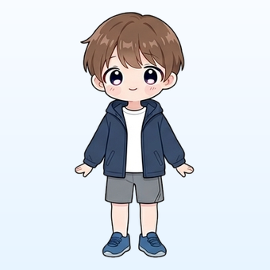 | **장마 · 레인재킷 + 반바지**<br>`m_summer_rain` | 비 | 레인재킷 `C134` · 반팔 티 `C001` · 숏 팬츠 `C028` · 방수 운동화 `C141` |
| 가을 | 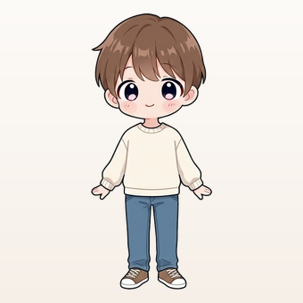 | **맨투맨 + 청바지**<br>`m_autumn_sweat` | 일상 | 맨투맨 `C017` · 워싱 청바지 `C033` · 기본 운동화 `C138` |
| 가을 | 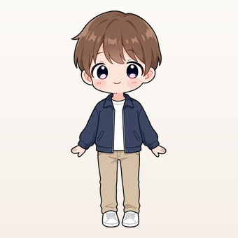 | **블루종 + 치노**<br>`m_autumn_blouson` | 일상 | 블루종 `C058` · 반팔 티 `C001` · 치노 팬츠 `C039` · 기본 운동화 `C138` |
| 가을 | 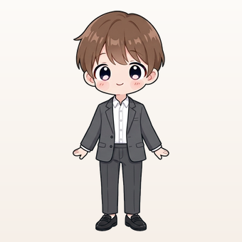 | **블레이저 + 셔츠 + 슬랙스**<br>`m_autumn_office` | 출근 | 블레이저 `C053` · 옥스퍼드 셔츠 `C012` · 슬랙스 `C038` · 로퍼 `C139` |
| 겨울 | 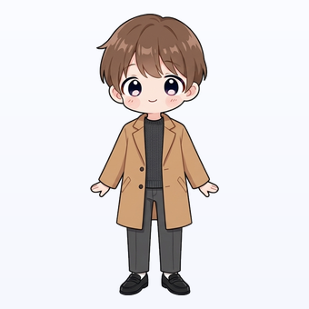 | **롱코트 + 니트 + 슬랙스**<br>`m_winter_coat` | 출근 | 롱코트 `C061` · 니트 `C022` · 기모 슬랙스 `C042` · 로퍼 `C139` |
| 겨울 | 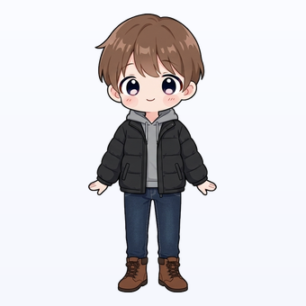 | **숏패딩 + 기모 청바지**<br>`m_winter_padding` | 일상 | 숏패딩 `C066` · 후드 티셔츠 `C019` · 기모 청바지 `C036` · 방한화 `C142` |
| 겨울 | 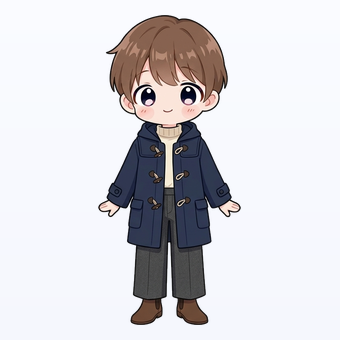 | **더플코트 + 터틀넥**<br>`m_winter_duffle` | 일상 | 더플코트 `C062` · 터틀넥 니트 `C025` · 울 팬츠 `C043` · 앵클부츠 `C140` |

## 5. 옷 아이콘 56개

카탈로그 옷 170개는 모두 아래 아이콘 중 하나에 연결됩니다(같은 모양의 옷은 같은 아이콘). 화면에는 아이콘 + **짧은 이름**을 보여 줍니다.
예) `C071` 발열 내의 상하의 → **따뜻한 상하의** · `C142` 접지력 있는 방수 방한화 → **방한화**

|   |   |   |   |   |   |   |
|---|---|---|---|---|---|---|
| <br>**반팔 티**<br>`tee_short` · 8개 | <br>**기능성 티**<br>`sport_tee` · 6개 | <br>**카라티**<br>`collar_tee` · 2개 | <br>**반팔 셔츠**<br>`shirt_short` · 3개 | 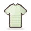<br>**여름 니트**<br>`knit_thin` · 4개 | 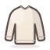<br>**긴팔 티**<br>`tee_long` · 4개 | <br>**셔츠**<br>`shirt` · 5개 |
| 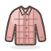<br>**체크·데님 셔츠**<br>`check_shirt` · 2개 | 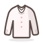<br>**블라우스**<br>`blouse` · 4개 | 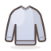<br>**맨투맨**<br>`sweatshirt` · 3개 | 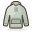<br>**후드티**<br>`hoodie` · 1개 | 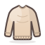<br>**니트**<br>`knit` · 5개 | 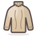<br>**터틀넥**<br>`turtleneck` · 2개 | 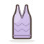<br>**조끼·뷔스티에**<br>`knit_vest` · 2개 |
| <br>**잠옷·라운지웨어**<br>`pajama` · 13개 | <br>**반바지**<br>`shorts` · 5개 | <br>**운동 반바지**<br>`sport_shorts` · 3개 | 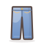<br>**청바지**<br>`jeans` · 7개 | 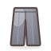<br>**슬랙스·면바지**<br>`slacks` · 5개 | 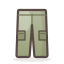<br>**카고 팬츠**<br>`cargo` · 1개 | 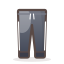<br>**조거·트레이닝**<br>`jogger` · 3개 |
| 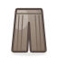<br>**기모·울 바지**<br>`warm_pants` · 4개 | <br>**레깅스**<br>`leggings` · 1개 | <br>**미니 스커트**<br>`skirt_mini` · 2개 | <br>**플리츠 스커트**<br>`pleats` · 2개 | <br>**미디 스커트**<br>`skirt_midi` · 4개 | <br>**롱스커트**<br>`skirt_long` · 3개 | <br>**가죽 스커트**<br>`leather_skirt` · 1개 |
| <br>**민소매 원피스**<br>`dress_sleeveless` · 2개 | <br>**반팔 원피스**<br>`dress_short` · 3개 | <br>**롱·셔츠 원피스**<br>`dress_long` · 2개 | <br>**니트 원피스**<br>`dress_knit` · 2개 | <br>**뷔스티에·멜빵치마**<br>`bustier_dress` · 2개 | <br>**점프수트·멜빵바지**<br>`jumpsuit` · 2개 | <br>**가디건**<br>`cardigan` · 4개 |
| <br>**바람막이**<br>`windbreaker` · 2개 | <br>**집업**<br>`zipup` · 4개 | <br>**사파리·야상**<br>`jacket_casual` · 3개 | <br>**블레이저**<br>`blazer` · 2개 | <br>**데님 재킷**<br>`denim_jacket` · 2개 | <br>**가죽 재킷**<br>`leather_jacket` · 2개 | <br>**블루종·항공점퍼**<br>`blouson` · 3개 |
| <br>**트렌치코트**<br>`trench` · 1개 | <br>**숏코트**<br>`coat_short` · 4개 | <br>**롱코트**<br>`coat_long` · 3개 | <br>**경량패딩·플리스**<br>`light_padding` · 4개 | <br>**패딩**<br>`padding` · 7개 | <br>**무스탕·퍼**<br>`fur` · 2개 | <br>**레인재킷**<br>`rain` · 2개 |
| <br>**운동화**<br>`sneakers` · 1개 | <br>**통풍 운동화**<br>`mesh_sneakers` · 1개 | <br>**로퍼**<br>`loafers` · 1개 | <br>**앵클부츠**<br>`boots` · 1개 | <br>**방수 운동화**<br>`rain_sneakers` · 1개 | <br>**방한화**<br>`winter_boots` · 1개 | <br>**따뜻한 상하의**<br>`thermal` · 1개 |

**노출이 많은 옷 7개**(나시 · 끈나시 · 스포츠 브라 · 요가 탑 등, JSON `notRecommended`)는 아이콘을 따로 만들지 않고
「시원한 반팔」 · 「운동용 상의」로 바꿔 보여 줍니다. 백엔드 추천에서 빼 주기를 요청했습니다.

## 6. 소품 19개

카탈로그에는 아직 소품이 없고, 백엔드 결과의 `accessories`도 비어 있습니다. 아래 기준은 **화면 시연용 초안**이며 최종 기준은 백엔드가 정합니다.
화면에는 **기본 3개, 비 · 미세먼지 날만 4개**까지 보여 줍니다. 우산은 비가 올 때만(눈만 올 때는 아님) 나옵니다.

| 아이콘 | 소품 | key | 추천 기준 (초안) |
|---|---|---|---|
|  | **우산** | `umbrella` | 비가 올 때 (pty가 비/비눈/빗방울 — 눈만 올 때는 아님) |
|  | **접이식 우산** | `folding_umbrella` | 비는 안 오지만 강수확률 40% 이상 |
|  | **장화** | `rain_boots` | 강수량 10mm 이상 |
|  | **양산** | `parasol` | 맑고 28℃ 이상 |
|  | **선글라스** | `sunglasses` | 맑고 20℃ 이상 |
|  | **선크림** | `sunscreen` | 맑거나 구름 많고 18℃ 이상 |
|  | **모자** | `cap` | 맑고 25℃ 이상 |
|  | **휴대용 선풍기** | `fan` | 30℃ 이상 또는 불쾌지수 80 이상 |
|  | **물병** | `water_bottle` | 28℃ 이상 또는 운동복 추천 |
|  | **쿨토시** | `cool_sleeve` | 30℃ 이상 |
|  | **겉옷 챙기기** | `light_outer` | 아우터를 입지 않았는데 일교차 10℃ 이상, 또는 아우터를 '챙기기'로 추천 |
|  | **목도리** | `scarf` | 5℃ 이하 |
|  | **장갑** | `gloves` | 0℃ 이하 |
|  | **비니** | `beanie` | 0℃ 이하, 또는 5℃ 이하에 바람 5m/s 이상 |
|  | **귀마개** | `earmuffs` | -5℃ 이하, 또는 3℃ 이하에 바람 8m/s 이상 |
|  | **핫팩** | `hotpack` | -5℃ 이하 |
|  | **보온 텀블러** | `thermos` | 3℃ 이하 |
|  | **립밤** | `lip_balm` | 습도 35% 이하 |
|  | **KF94 마스크** | `mask` | 미세먼지 '나쁨' 이상 (미세먼지 자료가 있을 때만) |

## 7. 그림을 더 만들거나 바꾸려면

세트 목록 · 아이콘 · 연결표를 만드는 프로그램은 `tools/outfit_link/`에 있습니다. 그림을 바꾸거나 세트를 늘릴 때 보시면 좋아요(경로는 원래 작업 폴더 기준).

1. `outfit_sets.py`에 세트 추가 (옷 id + 영어 옷 설명)
2. `py make_outfit_sets.py --prompts` → Gemini 요청문 · 안내 페이지 생성 (요청문 예: `docs/착장세트_요청문_Gemini.md`)
3. Gemini에서 같은 캐릭터 그림을 첨부해 한 장에 여러 벌 생성 → `py make_outfit_sets.py` 가 사람마다 잘라 카드 · MP4 · GIF 생성
4. `py build_map.py` → 이 폴더의 JSON · 아이콘 · 그림을 다시 만듦

## 8. 팀이 정할 것 (질문)

1. 노출이 많은 옷 7개를 추천에서 빼 줄 수 있는지
2. `outfits`가 여러 개 오면 첫 번째만 보여 주면 되는지
3. 소품을 카탈로그 · `accessories`에 넣을지, 이 기준 초안을 쓸지
4. 결과에 습도 · 풍속 · 강수확률 · 최저/최고 기온을 같이 보내 줄 수 있는지 (소품 기준에 필요)
5. 카드 실제 크기 (지금 파일 340×340, 목업에서는 240×240으로 표시)
